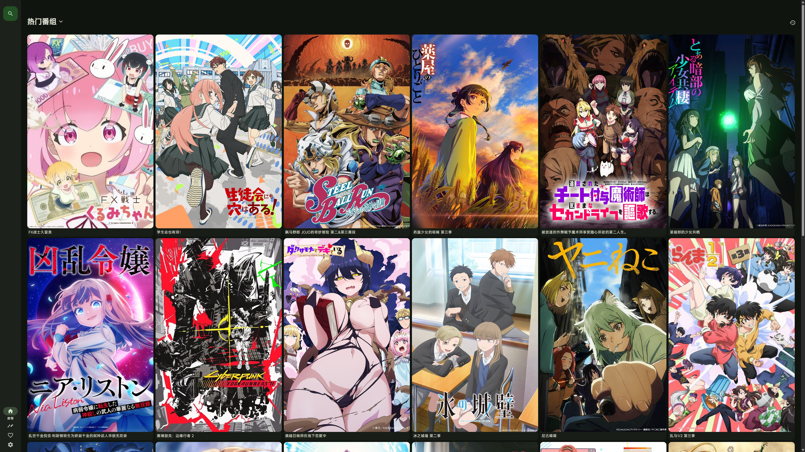
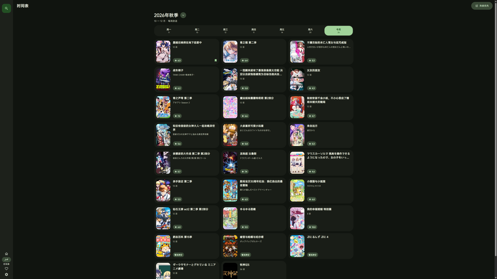
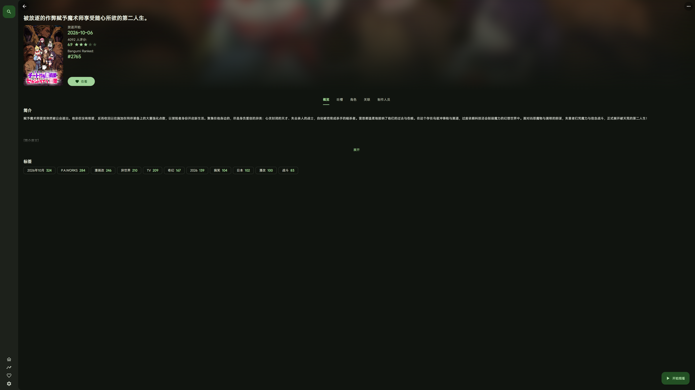
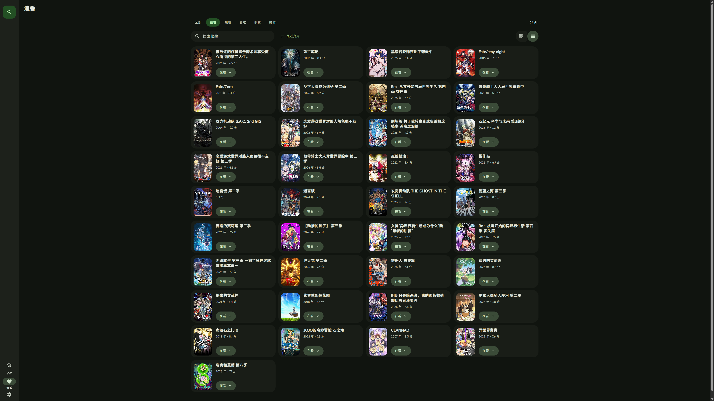
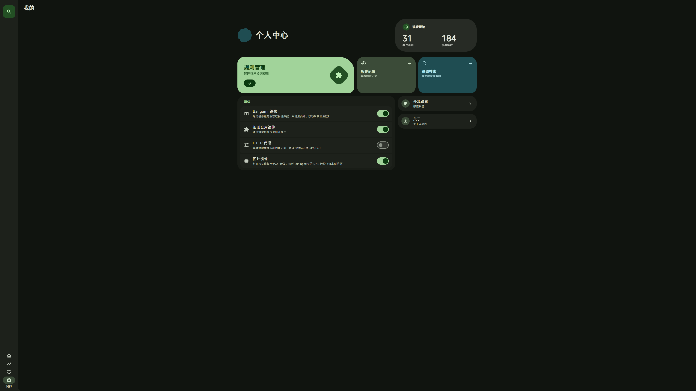
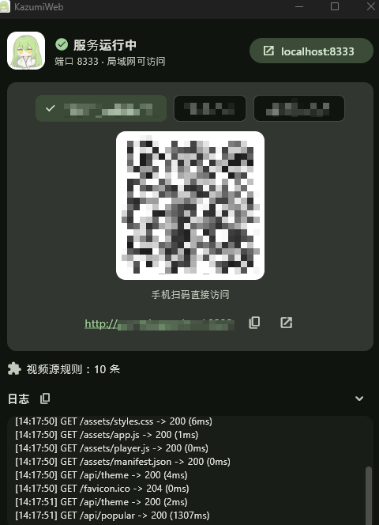

<div align=center>

<h1>KazumiWeb</h1>

</img>

</img>
</img>
<a href="https://github.com/0Chencc/KazumiWeb/actions/workflows/ci.yml"></img></a>

<p>把 <a href="https://github.com/Predidit/Kazumi">Kazumi</a> 搬进浏览器。在电脑上运行本程序，同一局域网内的手机、平板打开浏览器即可完成番剧浏览、检索、选源与播放。兼容 <a href="https://github.com/Predidit/KazumiRules">KazumiRules</a> 规则生态。绝赞开发中 (～￣▽￣)～</p>
</div>

## 为什么做 KazumiWeb

Kazumi 在 iOS 上只能侧载安装：自签证书要定期重签，免费证书 7 天就会过期，过期后应用直接打不开。对于只想安安静静追番的苹果用户，这套流程实在太折腾了。

KazumiWeb 换了一条路：让电脑来跑规则引擎和视频解析，iPhone / iPad 只需要一个浏览器。不用侧载，不用证书，不用担心哪天突然失效，「添加到主屏幕」之后用起来和原生应用一样。

## 支持平台

服务端（运行本程序的设备）：

- Windows 10 及以上
- macOS 13 及以上
- Linux（支持 Docker 部署，x64 / arm64）

客户端（访问网页的设备）：

- 任意现代浏览器，iOS Safari 优先适配
- iOS / iPadOS 可「添加到主屏幕」获得全屏 PWA 体验

## 屏幕截图

界面与交互对齐桌面版 Kazumi 的 Material 3 Expressive 设计，在浏览器里就是原汁原味的 Kazumi 体验。

<table>
  <tr>
    <td></td>
    <td></td>
    <td></td>
  </tr>
  <tr>
    <td></td>
    <td></td>
    <td></td>
  </tr>
</table>

## 功能 / 开发计划

- [X]  番剧推荐 / 标签筛选
- [X]  番剧时间表 / 往季新番
- [X]  番剧搜索 / 条件检索
- [X]  番剧详情（评论、角色、制作人员、关联作品）
- [X]  规则管理（规则仓库安装、链接 / JSON 导入）
- [X]  多视频源检索，选源后直达播放
- [X]  视频代理（Referer / UA 注入、m3u8 重写、HLS 广告过滤）
- [X]  视频源人机验证
- [X]  番剧弹幕（弹弹play，支持切换弹幕源）
- [X]  追番列表
- [X]  历史记录（按设备区分，跨设备续播）
- [X]  配色方案跟随桌面版
- [X]  桌面版 Kazumi 数据自动跟随（规则 / 追番 / 历史 / 设置）
- [X]  Bangumi / 规则仓库 / 图片镜像，HTTP 代理
- [X]  系统托盘常驻、开机自启
- [X]  无头模式与 Docker 部署
- [ ]  Web 端规则编辑器 / 规则测试 / 拖动排序 / 分享链接
- [ ]  端口设置界面
- [ ]  还有更多 (/・ω・＼)

## 下载

通过本页面 [Releases](https://github.com/0Chencc/KazumiWeb/releases) 选项卡下载对应平台的压缩包：

| 平台 | 文件 |
| --- | --- |
| Windows | `KazumiWeb-<版本>-windows-x64.zip` |
| macOS（Intel / Apple Silicon 通用） | `KazumiWeb-<版本>-macos-universal.zip` |
| Linux | `KazumiWeb-<版本>-linux-x64.tar.gz` / `KazumiWeb-<版本>-linux-arm64.tar.gz` |
| Docker | `ghcr.io/0chencc/kazumiweb`，见 [无头模式与 Docker](#无头模式与-docker) |

macOS 版未经 Apple 公证，首次打开会被系统拦截：在「系统设置 → 隐私与安全性」底部点击「仍要打开」，或执行 `xattr -dr com.apple.quarantine kazumi_web.app`。

Linux 版基于 Ubuntu 24.04 构建（需 Ubuntu 24.04 / Debian 13 及以上），运行前安装依赖：

```sh
sudo apt install libgtk-3-0t64 libwebkit2gtk-4.1-0 libayatana-appindicator3-1
```

## 使用



1. 在电脑上启动程序，窗口中会显示局域网访问地址与二维码
2. 手机扫描二维码即可直接打开网页，不用手动输入地址；iOS 可再「添加到主屏幕」获得全屏体验
3. 本机点击窗口右上角的 `localhost:8333` 按钮即可在浏览器中打开
4. 本机装有桌面版 Kazumi 时，规则 / 追番 / 历史 / 设置自动同步，开箱即用；否则在网页「我的 → 规则管理」安装规则
5. 关闭窗口后服务驻留系统托盘，托盘菜单可设置开机自启

局域网地址首选 `http://<主机名>.local:8333`，部分安卓浏览器不支持时可切换为 IP 地址。

<br clear="right">

### 无头模式与 Docker

无窗口、无托盘的纯服务进程，适合挂机场景：

```sh
# 命令行开关或环境变量二选一；KAZUMI_WEB_PORT 覆盖端口（默认 8333）
kazumi_web --headless
KAZUMI_WEB_HEADLESS=1 KAZUMI_WEB_PORT=8333 ./kazumi_web
```

Docker（Linux 容器，xvfb 虚拟显示承载 Flutter 与 webkitgtk WebView）：

```sh
docker run -d --network host -v kazumi-data:/data ghcr.io/0chencc/kazumiweb:latest

# 或从源码构建
docker compose up -d          # 或 docker build -t kazumi-web .
```

数据持久化在 `/data` 卷，推荐 `--network host` 让局域网设备直达。

## Q&A

<details>
<summary>使用者 Q&A</summary>

#### Q: 手机打不开 `.local` 地址？

A: 部分安卓浏览器不支持 mDNS 解析。请在窗口的地址列表中切换为 IP 地址，或直接扫描对应的二维码。

#### Q: 为什么少数番剧中有广告？

A: 本项目未插入任何广告。广告来自视频源，本程序会尽量过滤 HLS 插播广告，但无法保证完全去除。请不要相信广告中的任何内容，并尽量选择没有广告的视频源观看。

#### Q: 为什么检索时弹出了验证码？

A: 部分视频源启用了反爬人机验证。按网页提示完成验证后，检索会自动继续。

#### Q: 为什么视频经常加载失败？

A: 部分视频源直连质量不稳定，可在「我的 → 网络」开启 HTTP 代理，视频代理同样会经过该代理。

#### Q: 本程序和桌面版 Kazumi 是什么关系？

A: 本程序独立运行，不依赖也不修改桌面版 Kazumi，只是复用其开源的规则引擎与解析实现，规则存储格式与桌面版一致。本机装有桌面版时会自动跟随其数据，没有装也能单独使用。

#### Q: 可以在公网上开放吗？

A: 不建议。服务没有任何认证，任何能访问端口的人都可以操作。请只在可信的局域网中运行。

</details>

<details>
<summary>开发者 Q&A</summary>

#### Q: 自行编译后弹幕无法加载？

A: 弹幕功能需要弹弹play开放平台凭证，编译时通过 `--dart-define` 注入（与上游 Kazumi 相同）。缺省时弹幕接口返回 403，其余功能不受影响。

#### Q: 无头模式为什么仍然需要显示环境？

A: 视频源解析依赖 WebView，这是规则引擎的硬依赖。「无头」指窗口不可见，显示环境仍需存在（物理会话或 xvfb）。

</details>

## 开发

```sh
flutter pub get
flutter run -d windows        # 或 -d macos / -d linux
```

发行构建（弹幕凭证可选，`windows` 换成 `macos` / `linux` 即对应平台）：

```sh
flutter build windows --release \
  --dart-define=DANDANAPI_APPID=<appid> \
  --dart-define=DANDANAPI_KEY=<key>
```

发行布局：

- Windows：`build/windows/x64/runner/Release/` 全部内容，加上 `web/` 目录放在可执行文件旁边
- Linux：`build/linux/<x64|arm64>/release/bundle/` 全部内容，加上 `web/` 目录放在可执行文件旁边
- macOS：`build/macos/Build/Products/Release/kazumi_web.app`，`web/` 已在构建时打包进 `Contents/Resources/`，无需额外处理

### 目录结构

- `lib/main.dart` — Flutter 壳（状态窗口 + 服务引导）
- `lib/server.dart` — 局域网 HTTP 服务（静态文件 / API / 视频代理路由）
- `lib/core/` — 规则注册表、WebView 解析封装、历史收藏存储、主题导出
- `lib/bangumi_service.dart` — Bangumi 公开数据直连与镜像回退
- `lib/proxy/` — 视频代理（m3u8 重写、HLS 广告过滤、会话管理）
- `lib/plugins/` `lib/services/` `lib/request/` `lib/modules/` `lib/webview/` `lib/utils/` — 自上游 Kazumi 拷贝的核心模块
- `web/` — Web UI（纯 HTML / JS / CSS）

### 跟随上游同步

拷贝的模块保持与上游相同的文件路径，只有 import 前缀不同（`package:kazumi/` → `package:kazumi_web/`），**请不要在这些文件里做本地修改**，需要行为差异时在调用层解决。上游发新版后：

```sh
# 在 Kazumi 仓库中查看拷贝范围内的变更
git diff <old-tag>..<new-tag> -- lib/plugins lib/services/plugin \
  lib/services/video_source lib/webview/video lib/request lib/modules \
  lib/utils/episode_url.dart lib/utils/http_headers.dart
```

差异搬运后重跑 `flutter analyze` 即可发现签名级适配点。以下文件是有意的裁剪或替身，文件头有注明，同步时跳过：
`services/storage/storage.dart`、`utils/constants.dart`、`request/core/network_config.dart`、`webview/video/video_webview_controller.dart`。

`dio` 必须与上游 `pubspec.lock` 锁定同一版本，否则拷贝代码中的 `switch` 会因枚举不穷尽而编译失败。

## 美术资源

本项目图标来自 [Yuquanaaa](https://www.pixiv.net/users/66219277) 发表在 [Pixiv](https://www.pixiv.net/artworks/116666979) 上的作品，与 [Kazumi](https://github.com/Predidit/Kazumi) 使用同一图标。

此图标由其原作者 [Yuquanaaa](https://www.pixiv.net/users/66219277) 拥有版权。这一图标不是自由使用的，未经原作者明确授权，任何人不得擅自使用、复制、修改或分发这一图标。

本项目内嵌字体为 [Mi Sans](https://hyperos.mi.com/font/zh/details/sc/) 字体，由 [Xiaomi](https://www.mi.com/index.html) 开发和拥有版权。

## 免责声明

本项目包含来自 [Kazumi](https://github.com/Predidit/Kazumi) 的代码，基于 GNU 通用公共许可证第 3 版（GPL-3.0）授权。我们不对其适用性、可靠性或准确性作出任何明示或暗示的保证。在法律允许的最大范围内，作者和贡献者不承担任何因使用本软件而产生的直接、间接、偶然、特殊或后果性的损害赔偿责任。

使用本项目需遵守所在地法律法规，不得进行任何侵犯第三方知识产权的行为。因使用本项目而产生的数据和缓存应在 24 小时内清除，超出 24 小时的使用需获得相关权利人的授权。

## 隐私政策

我们不收集任何用户数据，不使用任何遥测组件。观看历史、追番与设置只保存在运行本程序的设备上。

为提供番剧数据、弹幕与图片，本程序会访问 Bangumi、弹弹play、Kazumi 镜像服务以及 [wsrv.nl](https://wsrv.nl) 图片镜像（可在「我的 → 网络」关闭），视频由你安装的规则所指向的视频源提供。

## 致谢

特别感谢 [Kazumi](https://github.com/Predidit/Kazumi) 本项目的规则引擎、视频源解析与弹幕实现均来自 Kazumi，界面设计同样以其为蓝本。

特别感谢 [KazumiRules](https://github.com/Predidit/KazumiRules) 及所有规则贡献者。

特别感谢 [Bangumi](https://bangumi.tv/) 本项目使用了 Bangumi 开放 API 以提供番剧元数据。

特别感谢 [弹弹play](https://www.dandanplay.com/) 本项目使用了 弹弹play开放平台 以提供弹幕交互。

感谢 [XpathSelector](https://github.com/simonkimi/xpath_selector) 规则引擎的选择器能力来自 XpathSelector。

感谢 [hls.js](https://github.com/video-dev/hls.js) 网页端 HLS 播放能力来自 hls.js。

感谢 [shelf](https://github.com/dart-lang/shelf) 本项目的 HTTP 服务基于 shelf。

感谢 [wsrv.nl](https://wsrv.nl) 提供图片镜像服务。
